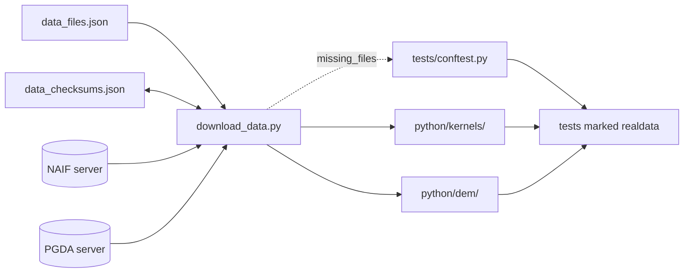
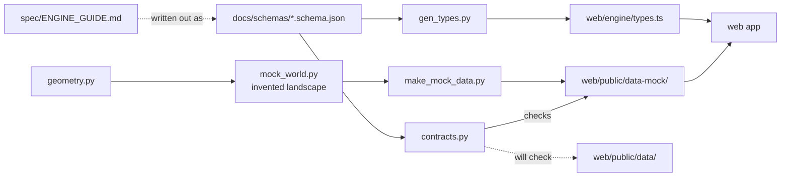
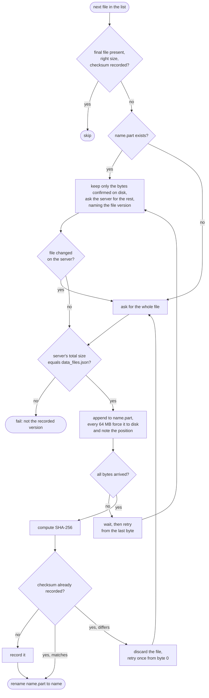

# Architecture

This page describes the code as it exists today. It grows with each pull request. The plan for what comes next is in [`PROGRESS.md`](PROGRESS.md).

## Modules

| Module | Job | Reads | Writes |
| --- | --- | --- | --- |
| `python/scripts/download_data.py` | Downloads the NASA input files, four at a time and started in a fixed order, resumes after an interruption, and verifies size and checksum. Refuses to run twice in the same folder. Also answers "is this group of data on disk?" for the tests. | `python/data_files.json`, `python/data_checksums.json`, the NAIF and PGDA servers | `python/kernels/`, `python/dem/`, `python/data_checksums.json`, `python/dem/download.log`, `python/dem/download.lock`, and a `name.part.json` side file next to each partial download |
| `python/tests/conftest.py` | Skips tests marked `realdata` while their data is missing and prints which ones were skipped. | What `download_data.missing_files` reports | Test report only |
| `python/lunar_engine/geometry.py` | Exact geometry on the reference sphere: latitude/longitude to a direction, the local east/north/up frame, azimuth and elevation. | Nothing | Nothing |
| `python/lunar_engine/contracts.py` | Decides whether a file, an API response or a whole data folder matches the contracts. | `docs/schemas/*.schema.json`, the files being checked | Nothing (returns a list of problems) |
| `python/lunar_engine/mock_world.py` | An invented landscape given by formulas, with a brute-force skyline, terrain patch and shade grid. Used only for mock data. | Nothing | Nothing |
| `python/scripts/make_mock_data.py` | Builds the mock data folder from the invented landscape. | `mock_world` | `web/public/data-mock/` |
| `python/scripts/gen_types.py` | Turns the schemas into TypeScript interfaces. | `docs/schemas/*.schema.json` | `web/engine/types.ts` |
| `python/scripts/validate_data.py` | Command-line front end of `contracts.py` for a data folder. | A data folder | Report on screen |

Data files that are not code:

| File | Job |
| --- | --- |
| `python/data_files.json` | The list of input files: URL, destination, size, group. Its order is the download order. |
| `python/data_checksums.json` | The SHA-256 of each file, recorded at its first download. |
| `python/DATA.md` | Why each file was chosen and what its label says. |

## Structure

## Contracts, types and mock data

The JSON Schemas are the machine-readable form of the contracts in `spec/ENGINE_GUIDE.md`. Everything else is derived from them or checked against them, so the two halves cannot drift apart unnoticed.

A test fails if `types.ts` differs from what the schemas generate, or if the committed mock folder breaks any contract.

Conventions fixed in `geometry.py` and used everywhere: "up" is away from the Moon's centre, "north" is along the meridian toward the north pole (away from the south pole at these sites), "east" completes the right-handed set, and azimuth runs from north through east.

## How one file is downloaded

A file without the `.part` ending has always passed these checks.

## Tests that need real data

Tests are marked with the data groups they need, for example `@pytest.mark.realdata("kernels")`. The groups are the ones in `data_files.json`: `kernels`, `coarse`, `full`, `sites5m`.

A group counts as present when every one of its files exists with the recorded size and has a recorded checksum. This check is quick and does not re-read the files; the full re-read is `download_data.py --verify`.

Every test run ends with a "Real-data tests" section listing each skipped test and the files it is waiting for.
