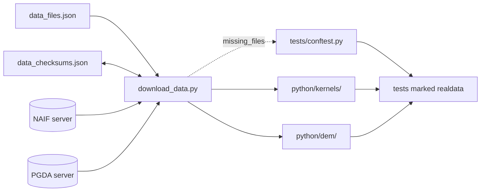
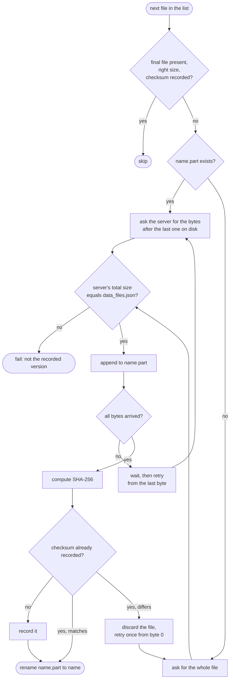

# Architecture

This page describes the code as it exists today. It grows with each pull request. The plan for what comes next is in [`PROGRESS.md`](PROGRESS.md).

## Modules

| Module | Job | Reads | Writes |
| --- | --- | --- | --- |
| `python/scripts/download_data.py` | Downloads the NASA input files in a fixed order, resumes after an interruption, and verifies size and checksum. Also answers "is this group of data on disk?" for the tests. | `python/data_files.json`, `python/data_checksums.json`, the NAIF and PGDA servers | `python/kernels/`, `python/dem/`, `python/data_checksums.json`, `python/dem/download.log` |
| `python/tests/conftest.py` | Skips tests marked `realdata` while their data is missing and prints which ones were skipped. | What `download_data.missing_files` reports | Test report only |

Data files that are not code:

| File | Job |
| --- | --- |
| `python/data_files.json` | The list of input files: URL, destination, size, group. Its order is the download order. |
| `python/data_checksums.json` | The SHA-256 of each file, recorded at its first download. |
| `python/DATA.md` | Why each file was chosen and what its label says. |

## Structure

## How one file is downloaded

A file without the `.part` ending has always passed these checks.

## Tests that need real data

Tests are marked with the data groups they need, for example `@pytest.mark.realdata("kernels")`. The groups are the ones in `data_files.json`: `kernels`, `coarse`, `full`, `sites5m`.

A group counts as present when every one of its files exists with the recorded size and has a recorded checksum. This check is quick and does not re-read the files; the full re-read is `download_data.py --verify`.

Every test run ends with a "Real-data tests" section listing each skipped test and the files it is waiting for.
