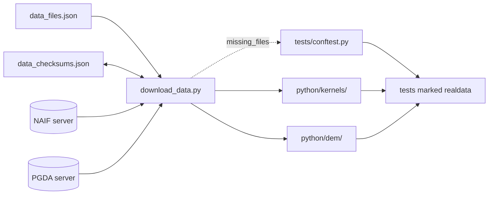
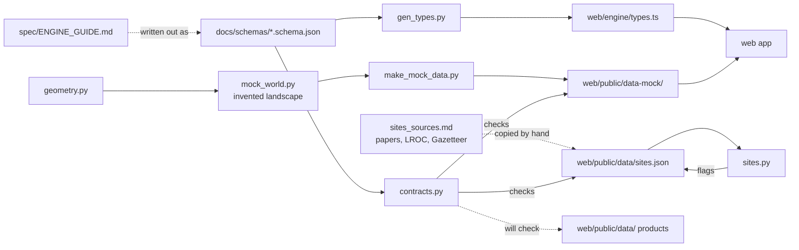
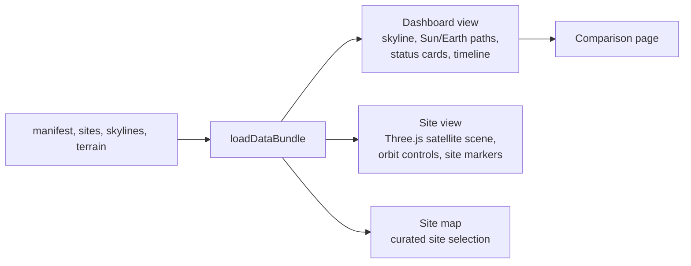
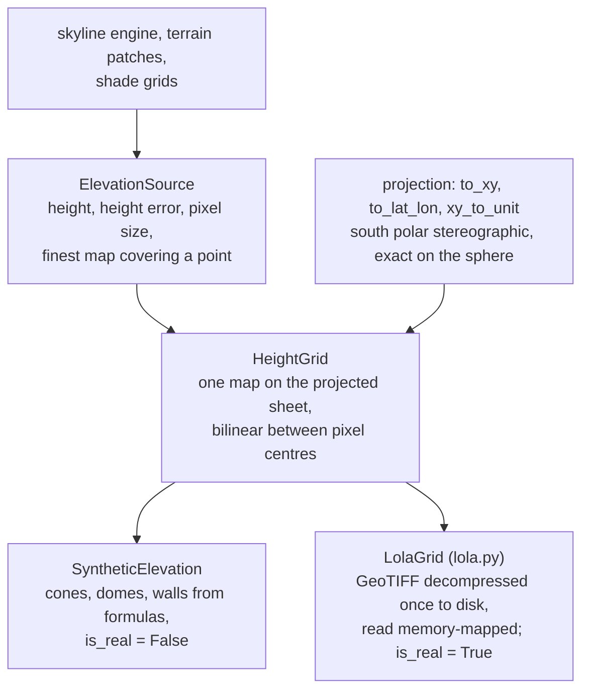
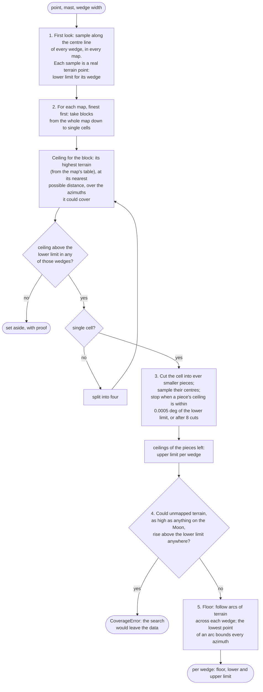
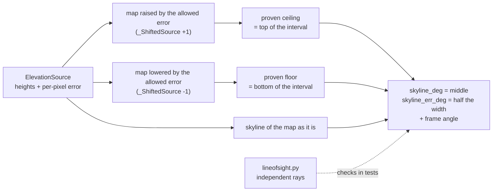
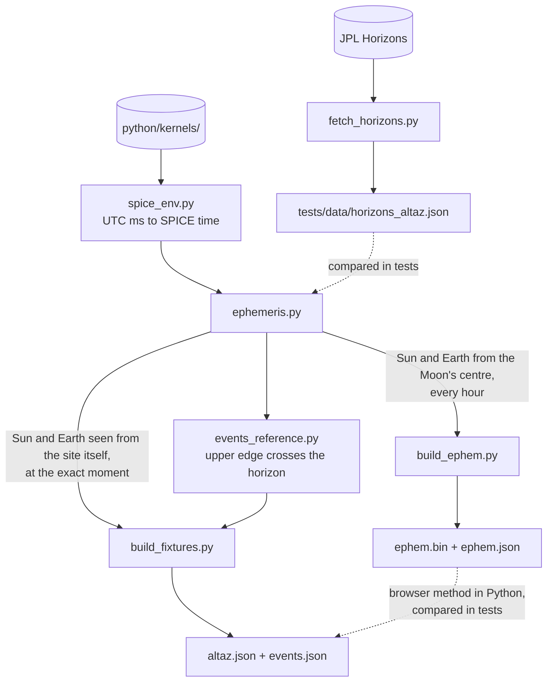
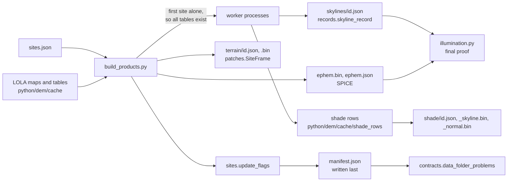

# Architecture

This page describes the code as it exists today. It grows with each pull request. The plan for what comes next is in [`PROGRESS.md`](PROGRESS.md).

## Modules

| Module | Job | Reads | Writes |
| --- | --- | --- | --- |
| `web/src/App.tsx` | Renders the mission dashboard, interactive Moon site view, curated-site map, timeline, comparison page and precision drawer. | `DataBundle`, browser engine results, URL state | React UI state |
| `web/src/visual-model.ts` | Samples browser engine results into chart-ready points and converts sky directions into SVG coordinates. | `DataBundle`, site skylines, selected time | `ScenarioSummary` and visual coordinates |
| `web/src/styles.css` | Provides the dark, glass-panel visual system and responsive layout for the dashboard and site view. | React class names | Browser styles |
| `python/scripts/download_data.py` | Downloads the NASA input files, four at a time and started in a fixed order, resumes after an interruption, and verifies size and checksum. Refuses to run twice in the same folder. Also answers "is this group of data on disk?" for the tests. | `python/data_files.json`, `python/data_checksums.json`, the NAIF and PGDA servers | `python/kernels/`, `python/dem/`, `python/data_checksums.json`, `python/dem/download.log`, `python/dem/download.lock`, and a `name.part.json` side file next to each partial download |
| `python/tests/conftest.py` | Skips tests marked `realdata` while their data is missing and prints which ones were skipped. | What `download_data.missing_files` reports | Test report only |
| `python/lunar_engine/geometry.py` | Exact geometry on the reference sphere: latitude/longitude to a direction, the local east/north/up frame, azimuth and elevation. | Nothing | Nothing |
| `python/lunar_engine/contracts.py` | Decides whether a file or a whole data folder matches the contracts. | `docs/schemas/*.schema.json`, the files being checked | Nothing (returns a list of problems) |
| `python/lunar_engine/mock_world.py` | An invented landscape given by formulas, with a brute-force skyline, terrain patch and shade grid. Used only for mock data. | Nothing | Nothing |
| `python/lunar_engine/elevation.py` | Terrain heights behind one interface (`ElevationSource`): the polar projection, a map grid with interpolation between pixel centres, nested maps answered from the finest, and "highest terrain in a block" tables. | Map grids | Nothing |
| `python/lunar_engine/skyline.py` | The skyline: for every azimuth wedge, a guaranteed interval for the highest elevation angle of any terrain, found by proving which areas cannot matter. | An `ElevationSource` | Nothing (returns a `SkylineResult`) |
| `python/lunar_engine/uncertainty.py` | The error bound `skyline_err_deg`: runs the skyline on the map raised and lowered by the error allowed at each point, and combines the results. | An `ElevationSource` with its error maps | Nothing (returns `SkylineBounds`) |
| `python/lunar_engine/lineofsight.py` | The independent check: lines of sight traced through the terrain, and the skyline at single exact azimuths by dense sampling. Shares no code with the skyline search. | An `ElevationSource` | Nothing |
| `python/lunar_engine/records.py` | The one place a Contract 3 skyline record is made (rounded so its interval never shrinks, checked against the contract) and written. Used by the Builder. | `uncertainty` | `skylines/{id}.json` |
| `python/lunar_engine/lola.py` | The real-data backend: reads the LOLA GeoTIFFs (checking their labels), decompresses each once into a memory-mapped file, and builds the highest-terrain tables strip by strip on disk; slopes and error allowances are computed on demand. | `python/dem/*.TIF` | `python/dem/cache/` |
| `python/scripts/build_dem_cache.py` | Prepares the caches of the four full-resolution maps up front, with progress. | `lola` | `python/dem/cache/` |
| `python/lunar_engine/sites.py` | The curated site list (Contract 2): checks it (schema, unique ids, service region, documented categories), sets its `has_terrain` / `has_shade_grid` flags from the files present, and describes the ground around a site for the map cross-check. | `web/public/data/sites.json`, an `ElevationSource` | `sites.json` (flags only) |
| `python/scripts/check_sites.py` | Prints the ground around each site on the real maps (the table in `python/sites_sources.md`). | `sites`, `lola` | Report on screen |
| `python/scripts/update_site_flags.py` | Sets the site flags after terrain patches or shade grids are built. | `sites` | `sites.json` |
| `python/lunar_engine/patches.py` | Terrain patches (Contract 4) and shade grids (Contract 5): the exact ground in the site's frame, surface normals, and each shade cell's skyline from the proven search, turned into the site's frame. | An `ElevationSource`, `skyline` | Arrays |
| `python/lunar_engine/illumination.py` | The final proof: how often each site certainly sees the Sun and the Earth over the whole timetable, from the products the web app receives. | A skyline record, the timetable | Shares of hours |
| `python/scripts/build_products.py` | Builds the whole real data folder (skylines, terrain, shade grids, timetable, flags, manifest) in parallel and resumably, then checks it. | `lola`, `records`, `patches`, `sites`, SPICE | `web/public/data/` |
| `python/scripts/check_illumination.py` | Prints the Sun and Earth visibility table of `docs/ACCURACY.md`. | `illumination`, `web/public/data/` | Report on screen |
| `python/lunar_engine/synthetic.py` | The synthetic backend: cones, domes and walls given by formulas, sampled onto grids like a real map. | Nothing | Nothing |
| `python/lunar_engine/spice_env.py` | Loads the SPICE kernels and converts UTC milliseconds to SPICE time at the edge. | `python/kernels/` | Nothing |
| `python/lunar_engine/ephemeris.py` | Where the Sun and Earth are: from the Moon's centre (for the timetable) and directly for a surface site (the reference answer). Also the browser's method written in Python, for measuring its error. | SPICE | Nothing |
| `python/lunar_engine/events_reference.py` | Reference rise and set times on a smooth Moon, for the fixtures only. | `ephemeris` | Nothing |
| `python/lunar_engine/products.py` | Shared file writers: JSON, the timetable, the manifest. | A data folder | Files in it |
| `python/scripts/build_ephem.py` | Builds the timetable (Contract 1). | SPICE via `ephemeris` | `ephem.bin`, `ephem.json`, refreshed `manifest.json` |
| `python/scripts/build_fixtures.py` | Builds the fixtures for the TypeScript tests (Contract 6). | SPICE via `ephemeris`, `events_reference` | `web/engine/tests/fixtures/altaz.json`, `events.json` |
| `python/scripts/fetch_horizons.py` | Fetches reference directions from JPL Horizons, for validation only. | The Horizons web service | `python/tests/data/horizons_altaz.json` |
| `python/scripts/make_mock_data.py` | Builds the mock data folder from the invented landscape. | `mock_world` | `web/public/data-mock/` |
| `python/scripts/gen_types.py` | Turns the schemas into TypeScript interfaces. | `docs/schemas/*.schema.json` | `web/engine/types.ts` |
| `python/scripts/validate_data.py` | Command-line front end of `contracts.py` for a data folder. | A data folder | Report on screen |

Data files that are not code:

| File | Job |
| --- | --- |
| `python/data_files.json` | The list of input files: URL, destination, size, group. Its order is the download order. |
| `python/data_checksums.json` | The SHA-256 of each file, recorded at its first download. |
| `python/DATA.md` | Why each file was chosen and what its label says. |
| `web/public/data/sites.json` | The 10 curated sites, written by hand: the only place site coordinates exist. |
| `python/sites_sources.md` | The source, exact words and map check of every site coordinate, and the category set. |

## Structure

## Contracts, types and mock data

The JSON Schemas are the machine-readable form of the contracts in `spec/ENGINE_GUIDE.md`. Everything else is derived from them or checked against them, so the two halves cannot drift apart unnoticed.

A test fails if `types.ts` differs from what the schemas generate, or if the committed mock folder breaks any contract.

The web app offers two primary experiences over the same prepared data:

Coordinates shown in the interface are read-only metadata from `sites.json`. The removed custom-coordinate workflow is intentionally not exposed by the UI.

The Site view keeps the supplied `Moon_Site_Viewer` experience as a separate browser scene. `web/src/SpaceScene.tsx` loads the prototype's Three.js 0.128 runtime and OrbitControls, creates the Moon, lighting, Sun, Earth, atmosphere, stars, and site markers, then disposes them when the React view changes. Site coordinates and the current Sun/Earth directions still come from the normal TypeScript data bundle; the scene does not open NASA files or run a second astronomy engine.

Conventions fixed in `geometry.py` and used everywhere: "up" is away from the Moon's centre, "north" is along the meridian toward the north pole (away from the south pole at these sites), "east" completes the right-handed set, and azimuth runs from north through east.

## Elevation: one interface, two backends

The terrain is defined as the bilinear blend between pixel centres. Each map is trusted only inside one disc: the largest disc around the map's centre that lies within its pixel centres and stops a pixel diagonal short of any missing value. At each point the terrain is that of the finest map whose disc contains it; a coarser map takes over where a finer one has a hole. Outside every disc there is no data: a height there raises `CoverageError` and is never guessed.

Two facts established by tests that the skyline search will rely on, with their limits:

- The projection never shrinks distances on the reference sphere: two points on the 1737.4 km sphere are never farther apart than on the sheet. Points standing on high ground are slightly farther apart than their feet (0.3 % at 5 km), so the search must allow for that factor.
- Each value of a "highest terrain" table is an upper limit for everything beneath it in that one map, with unknown terrain counted as high, not low. It says nothing about a finer map nested over the same area; each map needs its own table.

## The skyline search

Which map answers where: blocks wholly outside a map's trusted disc, or wholly inside a finer map's disc, are skipped for that map. Samples count for a map only where that map is the one trusted.

Three ceilings, each a proof; the lowest available is used:

- **Block ceiling** (any block): the block's highest terrain at its nearest possible distance.
- **Corner ceiling** (pieces of single cells): from the exact elevations of the piece's four corner points. The terrain inside the piece lies within a calculable distance (far below a millimetre) of the solid spanned by those points, and no direction into that solid looks higher than its highest corner except by a second-order amount.
- **Per-wedge ceiling** (pieces covering 2 to 1024 wedges): the corner argument applied to only the part of the solid inside one wedge, cut by the wedge's two vertical edge planes. Without it, a piece's highest part would raise every wedge it touches. It is used only when the solid provably keeps clear of the line where the two edge planes cross (the vertical through the eye); otherwise the piece keeps its single ceiling.

The four facts that make the block ceilings proofs and not estimates are listed in the docstring of `skyline.py`. In short: ground inside a cell is never above its highest corner; distances on the sphere are never longer than on the sheet, so a block lies inside a known circle on the sphere; elevation angle at a given height first rises and then falls with distance; and the azimuths of a circle seen from the eye are exactly known. Height does not change azimuth, because the eye is on the vertical.

Choices fixed in `skyline.py`: ground within 1 m of the point under the eye is not an obstacle; the target interval half-width is 0.0005°; a cell is cut at most 8 times (to 1/256 of a pixel).

## The error bound

The interval of a wedge contains the skyline at every single azimuth in it, for any terrain within the error model:

- the top is a ceiling over the whole wedge (the skyline search's upper limit);
- the bottom is a floor under every azimuth of the wedge (step 5 of the search: arcs of terrain followed across the wedge).

So a direction above the interval is certainly clear, and one below it is certainly blocked.

The allowed error at a point is `min(E(x) + E(site), max(0, D - r0) * tan(6°))`, with `E = 3 * sigma + horizontal error * local slope`, `D` the distance from the site and `r0` one pixel diagonal. The reasons for each part are in the docstring of `uncertainty.py`; the values are proposals awaiting approval (`docs/PROGRESS.md`).

## Timetable and fixtures

The timetable and the fixtures both come from SPICE but by different routes, so that the fixtures can test the timetable.

Times are UTC milliseconds since 1970 everywhere except inside `spice_env.py`, and angles are degrees everywhere except inside the trigonometry. SPICE's own time scale and radians never leave those modules.

## How one file is downloaded

A file without the `.part` ending has always passed these checks.

## Tests that need real data

Tests are marked with the data groups they need, for example `@pytest.mark.realdata("kernels")`. The groups are the ones in `data_files.json`: `kernels`, `coarse`, `full`, `sites5m`.

A group counts as present when every one of its files exists with the recorded size and has a recorded checksum. This check is quick and does not re-read the files; the full re-read is `download_data.py --verify`.

Every test run ends with a "Real-data tests" section listing each skipped test and the files it is waiting for.

## Building the real data folder

Map caches are identified by each source file's name, size, date and recorded checksum. A failed read of `data_checksums.json` (it is replaced while downloads run) is retried, never taken as "no checksum", and cache records are written in one step. Otherwise a cache can look out of date and parallel workers rebuild the same table at once, as happened once during the first real build.
