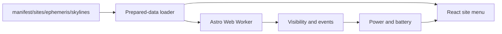

# Web architecture

The browser reads prepared products from one folder and performs all user-time calculations locally.

The web engine uses degrees at its public boundaries, UTC milliseconds for time, and kilometres for Sun/Earth vectors. The mock files are synthetic and are always labelled in the UI.
