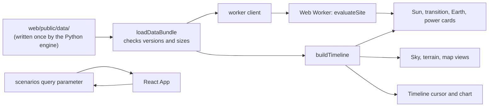
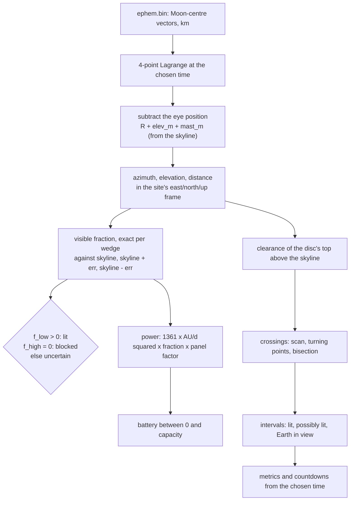
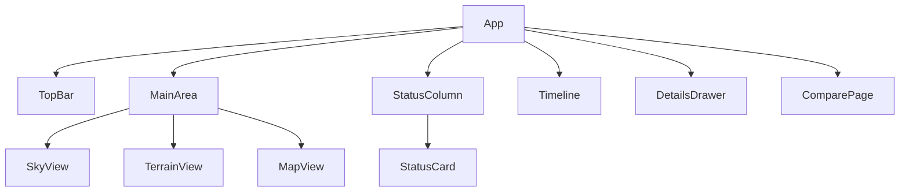

# Web application architecture

The web application is a static site. It reads prepared products from one folder (`VITE_DATA_FOLDER`: `/data-mock` by default, `/data` for the real sites) and does every calculation that depends on the chosen time or settings in the browser. It never opens NASA files and needs no server.

| Module | Job | Reads | Writes |
| --- | --- | --- | --- |
| `web/engine/data.ts` | Load and check the configured data folder: `version`, binary sizes against labels and against the manifest's `bytes`, little-endian decoding | `manifest.json`, labels, binary products | `DataBundle` |
| `web/engine/astro.ts` | Timetable interpolation (4-point Lagrange; refuses times outside the table), site position, east/north/up frame, azimuth and elevation, disc radii (Sun 695,700 km, Earth 6356.7519 km), step-function skyline reading | Timetable, site, time | `Direction` |
| `web/engine/visibility.ts` | Exact visible fraction of a disc against the skyline, nominal and ± error, the disc's clearance above the skyline, and the lit / blocked / uncertain verdict | `Direction`, `Skyline` | `Visibility` |
| `web/engine/events.ts` | Zero crossings of a clearance curve (10-minute scan, turning-point search, bisection): sunrise, sunset, Earthrise, Earthset | Timetable, `Skyline`, window | Event times |
| `web/engine/metrics.ts` | Intervals from crossings; sunlight, uncertain and Earth hours, longest night, both-visible windows, countdowns from the chosen time | Crossings, events | `MissionMetrics` |
| `web/engine/power.ts` | Irradiance, panel factors (flat, tracking, fixed with tilt from horizontal), battery integration with exact run-out time | Sun direction, visible fraction, settings | Power, charge history |
| `web/engine/evaluate.ts` | One site, time and window: directions, verdicts, events, metrics. Eye height from the skyline record | All of the above | `Evaluation` |
| `web/engine/worker.ts`, `client.ts` | Run `evaluateSite` in one long-lived Web Worker; the timetable is sent once | `DataBundle` | `Evaluation` |
| `web/src/visual-model.ts` | Sample directions and verdicts for the chart; take sunlight hours and countdowns from the engine | `DataBundle`, site, window | `ScenarioSummary` |
| `web/src/formatting.ts` | Format every user-facing number and time | Numeric values, UTC milliseconds | Display strings |
| `web/src/App.tsx` | Compose dashboard, tabs, cards, drawer, map and compare page | Loader, visual model, worker client, URL state | React view state |
| `web/src/url-state.ts` | Preserve up to four scenarios in the page URL | Query string, scenarios | Query string |

## Main data flow

## Inside one evaluation

## Component structure

The beginner screen intentionally exposes only the site/time controls, one main view, four status cards and the timeline. Expert mode adds exact values and opens the Details drawer. Comparison is a separate page so it cannot compete with the first answer.

## Tests

`cd web; npm test`. The audit tests in `web/engine/tests/audit/` compare the engine with SPICE, JPL Horizons, the Python engine and closed forms. They also validate every data file against `docs/schemas/`. See `docs/WEB_AUDIT.md`.

The 3D view is not on `main` yet: its code is on the `yacin1102-lunar-web-3d` branch.
