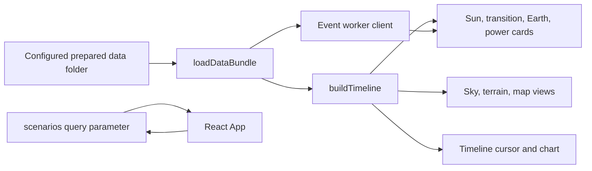
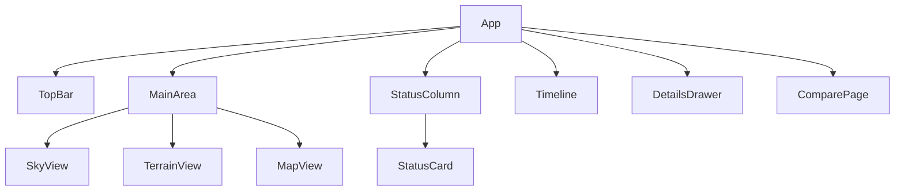

# Web application architecture

The web application is a thin presentation layer over prepared products and the existing browser engine. It does not open NASA files or duplicate astronomy formulas.

| Module | Job | Reads | Writes |
| --- | --- | --- | --- |
| `web/engine/data.ts` | Load and decode the configured data folder | `manifest.json`, labels, binary products | `DataBundle` |
| `web/engine/client.ts` | Run event evaluation away from the UI thread | `DataBundle`, UTC window | Worker result |
| `web/src/visual-model.ts` | Sample the existing engine for display windows | `DataBundle`, site, skyline, UTC window | `ScenarioSummary` |
| `web/src/formatting.ts` | Format every user-facing number and time | Numeric values, UTC milliseconds | Display strings |
| `web/src/App.tsx` | Compose dashboard, tabs, cards, drawer, map, and compare page | Loader, visual model, URL state | React view state |
| `web/src/url-state.ts` | Preserve up to four scenarios in the page URL | Query string, scenarios | Query string |

## Main data flow

## Component structure

The beginner screen intentionally exposes only the site/time controls, one main view, four status cards, and the timeline. Expert mode adds exact values and opens the Details drawer. Comparison is a separate page so it cannot compete with the first answer.

## 3D view boundary

The 3D view is loaded lazily from `web/src/three/` and consumes only the display terrain patch, shade grid, and directions already produced for the selected time. Its coordinate conversion and brightness helpers are tested independently; the astronomy engine remains unchanged.
