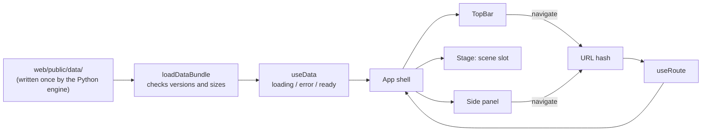
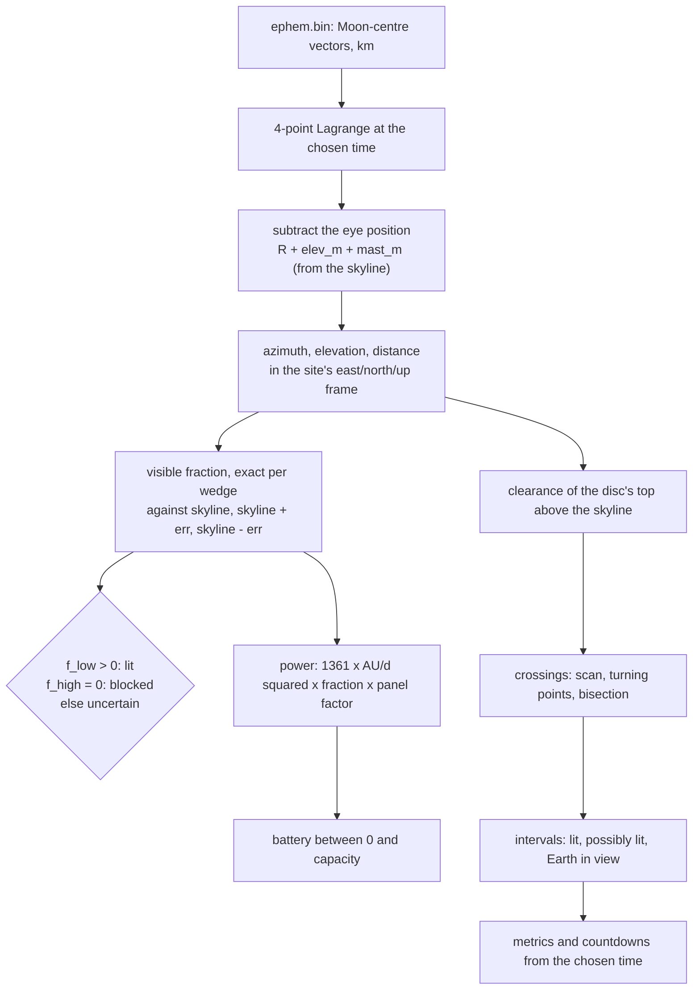
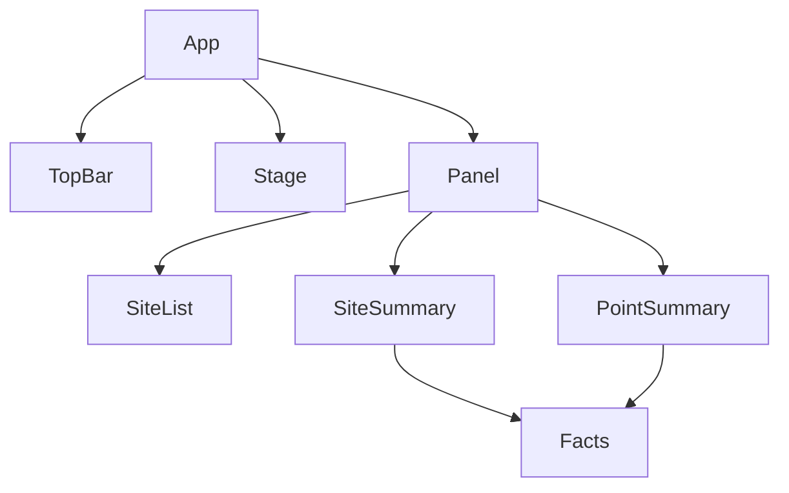

# Web application architecture

The web application is a static site. It reads prepared products from one folder (`VITE_DATA_FOLDER`; `web/vite.config.ts` sets it to `/data`, the real sites, unless it is already set) and does every calculation that depends on the chosen time or settings in the browser. It never opens NASA files and needs no server.

| Module | Job | Reads | Writes |
| --- | --- | --- | --- |
| `web/engine/data.ts` | Load and check the configured data folder: `version`, binary sizes against labels and against the manifest's `bytes`, little-endian decoding | `manifest.json`, labels, binary products | `DataBundle` |
| `web/engine/astro.ts` | Timetable interpolation (4-point Lagrange; refuses times outside the table), site position, east/north/up frame, azimuth and elevation, disc radii (Sun 695,700 km, Earth 6356.7519 km), step-function skyline reading | Timetable, site, time | `Direction` |
| `web/engine/visibility.ts` | Exact visible fraction of a disc against the skyline, nominal and ± error, the disc's clearance above the skyline, and the lit / blocked / uncertain verdict | `Direction`, `Skyline` | `Visibility` |
| `web/engine/events.ts` | Zero crossings of a clearance curve (10-minute scan, turning-point search, bisection): sunrise, sunset, Earthrise, Earthset | Timetable, `Skyline`, window | Event times |
| `web/engine/metrics.ts` | Intervals from crossings; sunlight, uncertain and Earth hours, longest night, both-visible windows, countdowns from the chosen time | Crossings, events | `MissionMetrics` |
| `web/engine/power.ts` | Irradiance, panel factors (flat, tracking, fixed with tilt from horizontal), battery integration with exact run-out time | Sun direction, visible fraction, settings | Power, charge history |
| `web/engine/evaluate.ts` | One site, time and window: directions, verdicts, events, metrics. Eye height from the skyline record | All of the above | `Evaluation` |
| `web/engine/worker.ts`, `client.ts` | Run `evaluateSite` in one long-lived Web Worker; the timetable is sent once | `DataBundle` | `Evaluation` |
| `web/src/formatting.ts` | Format durations, powers, angles and UTC times | Numeric values, UTC milliseconds | Display strings |
| `web/src/state/route.ts`, `useRoute.ts` | The address: scene, site or point, and time, as the URL hash | `location.hash` | `Route` |
| `web/src/state/useData.ts` | Load the data once; report loading, error or ready | `loadDataBundle` | `DataState` |
| `web/src/lib/sites.ts` | Group sites by category, write headings and positions | `Site[]` | Display strings |
| `web/src/App.tsx` | The shell: top bar, stage, one side panel; loading, error and mock-data states | Route, `DataState` | React view |
| `web/src/ui/` | `TopBar` (Globe/Map toggle), `Stage` (scene slot), `SiteList`, `SiteSummary`, `PointSummary`, `Facts` | Route, `DataBundle` | React view |
| `web/vite.config.ts` | Default data folder `/data`; remove `data-mock` from `dist/` after the build | `public/` | `dist/` |
| `web/e2e/`, `web/playwright.config.ts` | Browser tests and screenshots at 1440×900 and 390×844 against the production build | `dist/` | `docs/screenshots/` |

The interface is being rebuilt in nine parts (`docs/UI_PLAN.md`). The scenes (globe, polar map, site terrain, sky view, geometry) do not exist yet; this file gains a row for each as it is built.

## Main data flow

The worker client (`evaluateInWorker`) is not called by the shell yet. It is wired in with the time controls and readouts (part 7).

## Inside one evaluation

## Component structure

At most one side panel is open. Which one depends only on the route.

## Tests

- `cd web; npm test`: unit tests (vitest). The audit tests in `web/engine/tests/audit/` compare the engine with SPICE, JPL Horizons, the Python engine and closed forms, and validate every data file against `docs/schemas/` (`docs/WEB_AUDIT.md`). The UI adds tests for the route and the site helpers, the latter against the real `sites.json`.
- `cd web; npm run e2e`: builds the app, serves the build and runs the browser tests (Playwright, Chromium) in both viewports. They assert zero console errors and failed requests, that every site of `sites.json` is listed, that a failed data load shows an error and no result, and that `dist/` holds the real data and no mock data. First use on a machine: `npx playwright install chromium`.
