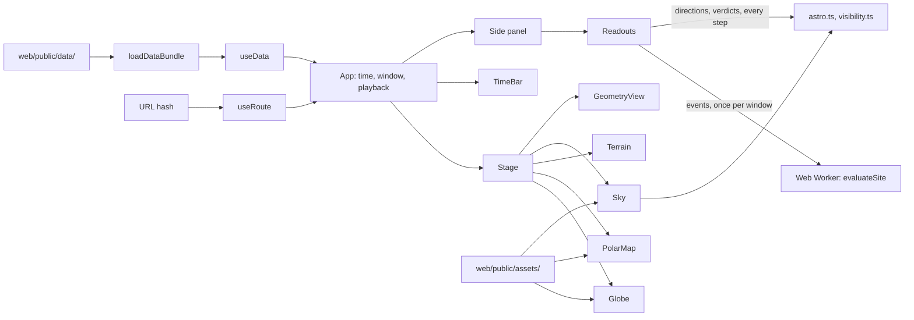
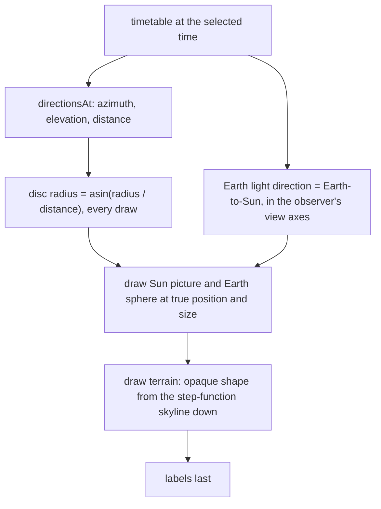
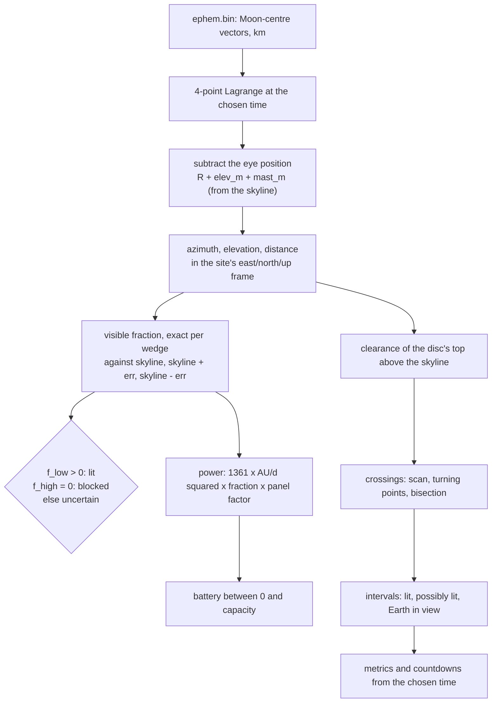
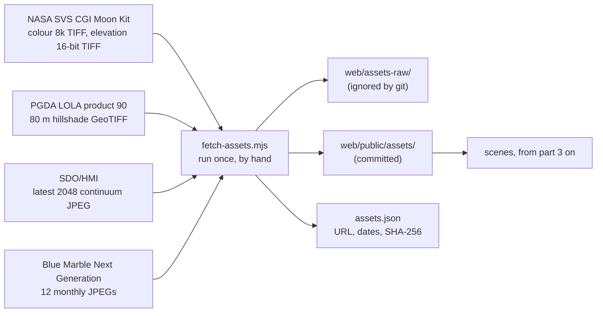

# Web application architecture

The web application is a static site. It reads prepared products from one folder (`VITE_DATA_FOLDER`; `web/vite.config.ts` sets it to `/data`, the real sites, unless it is already set) and does every calculation that depends on the chosen time or settings in the browser. It never opens NASA files and needs no server.

| Module | Job | Reads | Writes |
| --- | --- | --- | --- |
| `web/engine/data.ts` | Load and check the configured data folder: `version`, binary sizes against labels and against the manifest's `bytes`, little-endian decoding | `manifest.json`, labels, binary products | `DataBundle` |
| `web/engine/astro.ts` | Timetable interpolation (4-point Lagrange; refuses times outside the table), site position, east/north/up frame, azimuth and elevation, disc radii (Sun 695,700 km, Earth 6356.7519 km), step-function skyline reading | Timetable, site, time | `Direction` |
| `web/engine/visibility.ts` | Exact visible fraction of a disc against the skyline, nominal and ± error, the disc's clearance above the skyline, and the lit / blocked / uncertain verdict | `Direction`, `Skyline` | `Visibility` |
| `web/engine/events.ts` | Zero crossings of a clearance curve (10-minute scan, turning-point search, bisection): sunrise, sunset, Earthrise, Earthset | Timetable, `Skyline`, window | Event times |
| `web/engine/metrics.ts` | Intervals from crossings; sunlight, uncertain and Earth hours, longest night, both-visible windows, countdowns from the chosen time | Crossings, events | `MissionMetrics` |
| `web/engine/power.ts` | Irradiance, panel factors (flat, tracking, fixed with tilt from horizontal), battery integration with exact run-out time | Sun direction, visible fraction, settings | Power, charge history |
| `web/engine/evaluate.ts` | One site, time and window: directions, verdicts, events, metrics. Eye height from the skyline record | All of the above | `Evaluation` |
| `web/engine/worker.ts`, `client.ts` | Run `evaluateSite` in one long-lived Web Worker; the timetable is sent once | `DataBundle` | `Evaluation` |
| `web/src/formatting.ts` | Format durations, powers, angles and UTC times | Numeric values, UTC milliseconds | Display strings |
| `web/src/state/route.ts`, `useRoute.ts` | The address: scene, site or point, and time, as the URL hash | `location.hash` | `Route` |
| `web/src/state/useData.ts` | Load the data once; report loading, error or ready | `loadDataBundle` | `DataState` |
| `web/src/lib/sites.ts` | Group sites by category, write headings and positions | `Site[]` | Display strings |
| `web/src/lib/geometry.ts` | Display math: angular size, Earth phase and lit fraction, coordinate validation, polar projection both ways, log scale, axis conversions | Vectors, angles | Numbers |
| `web/src/lib/shade.ts` | Share of the Sun above each shade-grid cell's skyline; cell light; bilinear reading | `ShadeGrid`, Sun direction | Float32 grids |
| `web/src/App.tsx` | Shell and state: selected time, 30-day window, playback, tab, power assumptions | Route, `DataState` | React view |
| `web/src/ui/Stage.tsx` | Pick the scene for the route and tab | Route, `DataBundle`, time | Scene |
| `web/src/scenes/Globe.tsx` | three.js Moon with colour, true-scale relief, true Sun direction, HTML markers | `assets/moon/*`, timetable, sites | WebGL canvas |
| `web/src/scenes/PolarMap.tsx` | Hillshade positioned by its sidecar; markers, scale bar, cursor position | `assets/hillshade/*`, sites | DOM |
| `web/src/scenes/Terrain.tsx` | three.js mesh of the terrain patch, vertex brightness from slopes and the shade grid | `TerrainPatch`, `ShadeGrid`, Sun direction | WebGL canvas |
| `web/src/scenes/Sky.tsx` | 2D canvas: Sun and Earth, then the skyline in front; Earth rendered by a small three.js scene | `Skyline`, timetable, `assets/sun`, `assets/earth` | Canvas |
| `web/src/scenes/GeometryView.tsx` | SVG of Moon, Earth, Sun: true angle, log distances | Timetable | SVG |
| `web/src/ui/Readouts.tsx` | Verdicts, fractions, countdowns, battery for a site; directions for a custom point | Engine functions, worker client | React view |
| `web/src/ui/TimeBar.tsx`, `CoordinateInput.tsx`, `About.tsx`, `TopBar.tsx`, `SiteList.tsx`, `SiteSummary.tsx`, `PointSummary.tsx`, `Facts.tsx` | Controls and panels | State, `assets.json` | React view |
| `web/vite.config.ts` | Default data folder `/data`; remove `data-mock` from `dist/` after the build | `public/` | `dist/` |
| `web/scripts/fetch-assets.mjs` | Download the NASA imagery once, convert it to web sizes, record every file. Not part of the app: run by hand (`npm run fetch-assets`) | NASA servers, `web/assets-raw/` | `web/public/assets/`, `assets.json` |
| `web/scripts/assets.test.ts` | Check the committed pictures against `assets.json` and against what the app will assume about them | `web/public/assets/` | Test results |
| `web/e2e/`, `web/playwright.config.ts` | Browser tests and screenshots at 1440×900 and 390×844 against the production build | `dist/` | `docs/screenshots/` |

## Main data flow

## How the sky view stays honest

The terrain is drawn after the bodies, so it hides exactly what lies below the skyline. Nothing computes a "clipped disc" separately; the readout's fraction comes from the engine and the picture from the drawing order, and a browser test checks that the two agree on real pixels.

## Inside one evaluation

## Imagery

| File | Size | What the app must know |
| --- | --- | --- |
| `moon/lroc_color_4096.jpg` | 4096 x 2048 | Latitude/longitude grid, 0 degrees longitude in the middle, north at the top |
| `moon/ldem_4096_uint16.png` | 4096 x 2048, 16-bit | Same grid. Height above the 1737.4 km sphere in metres = `count * 0.5 - 10000`. A browser flattens a PNG to 8 bits when it is used as a texture, so the app must decode this file itself |
| `hillshade/south_pole_hillshade.png` + `.json` | 3800 x 3800 | South polar stereographic, pole at the centre, 160 m per pixel, to 80 degrees south. The sidecar gives the corner coordinates in metres and the pixel-to-map formula |
| `sun/sun_hmi_2048.png` | 1891 x 1891, grey + alpha | Cropped to the disc: the picture's width is the Sun's diameter. Greyscale with real limb darkening |
| `earth/bmng_01.jpg` to `bmng_12.jpg` | 4096 x 2048 | Latitude/longitude grid, 0 degrees longitude in the middle. Use the month of the selected UTC date |

The hillshade's projection values are not typed in: the script reads them from the GeoTIFF's tags and writes them to the sidecar. The Sun's disc is found in the image itself (the longest run of bright rows and columns), not assumed.

## Tests

- `cd web; npm test`: unit tests (vitest).
  - `web/engine/tests/audit/`: the engine against SPICE, JPL Horizons, the Python engine and closed forms (`docs/WEB_AUDIT.md`).
  - `web/src/lib/geometry.audit.test.ts`: angular sizes (formula, and range over the whole timetable); Earth lit fraction `(1 + cos phase) / 2` against five JPL Horizons values saved with their query in `web/src/lib/fixtures/earth_phase_horizons.json`; every `altaz.json` case within 0.01 degrees; coordinate validation; the polar projection round trip for every site and against the hillshade's sidecar; shade-grid lighting on a real grid.
  - `web/scripts/assets.test.ts`: the committed pictures against `assets.json`.
  - The 60-second event check against `events.json` is the engine's own audit test and is unchanged.
- `cd web; npm run e2e`: builds the app and runs `web/e2e/app.spec.ts` in Chromium at 1440x900 and 390x844: every scene with a screenshot and zero console errors, coordinate refusals, time controls, About, a failed data load, no mock data in `dist/`. On the desktop viewport three more tests use a probe mode (`&probe=sun` or `&probe=earth`: no labels, no glow, the disc 150 pixels in radius) to count screen pixels: the visible share of a half-set Sun against the engine (5 %), the Earth's lit share against the formula with Magnify off and on (2 %), and a frame-rate report. First use on a machine: `npx playwright install chromium`.
